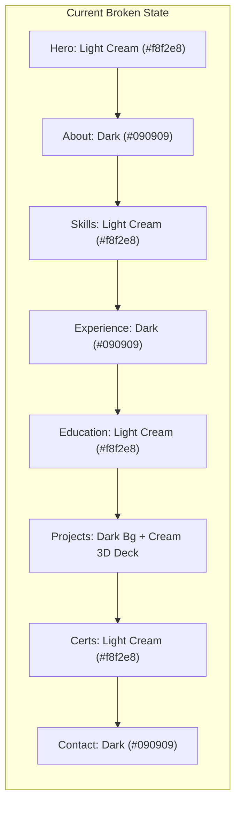
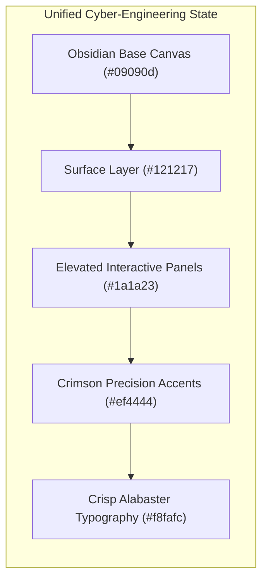
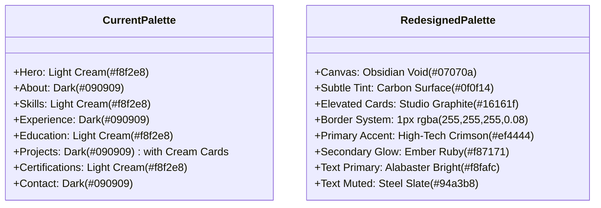
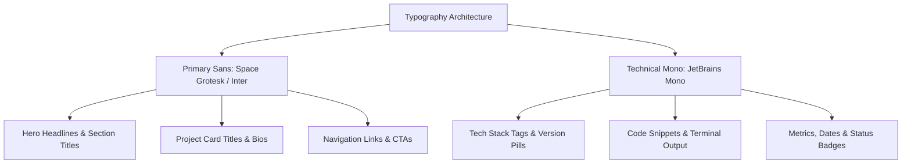
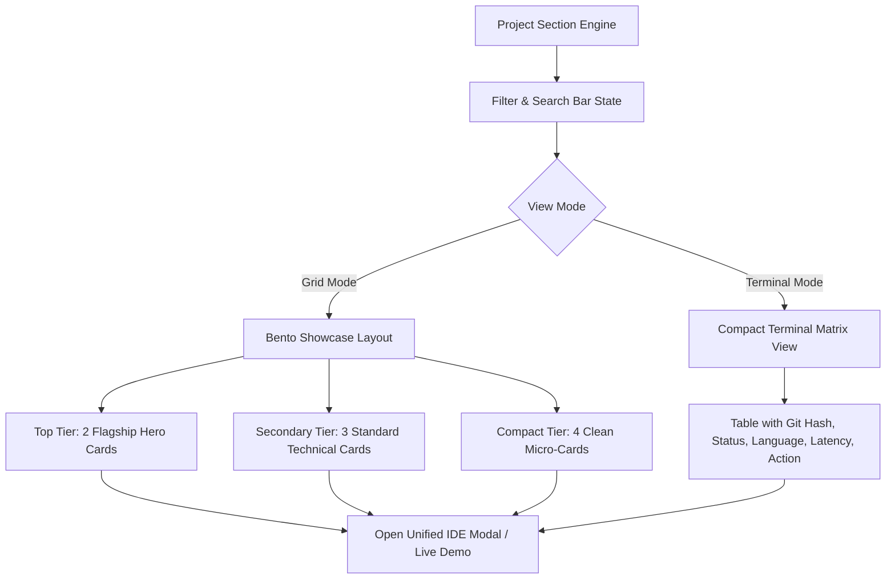
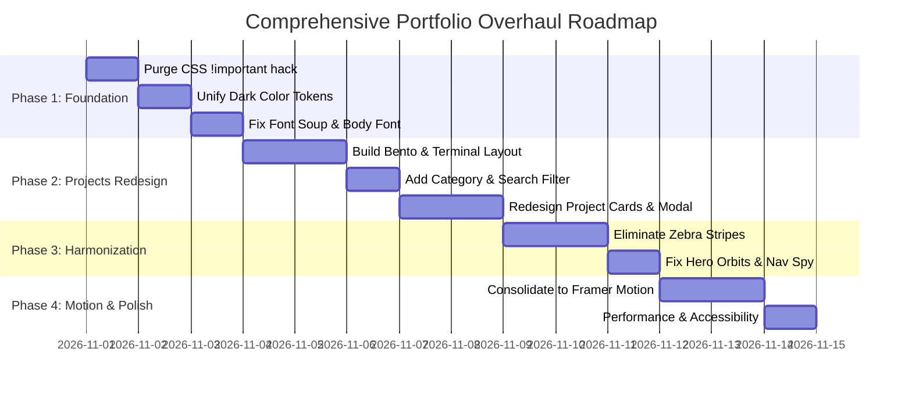

# 🎨 Comprehensive UI/UX Design, Layout & Architecture Overhaul

> **Document Type:** Master UI/UX Audit, Design System Specification & Implementation Blueprint  
> **Project:** [Animated 3D Portfolio](https://github.com/NITHINKR06/Animated_Portfolio) — Nithin K R  
> **Target Audience:** Frontend Architects, Designers, Reviewers, and Portfolio Maintainers  
> **Status:** Critical Architecture Plan & Actionable Fix Matrix  

---

## 📑 Table of Contents

1. [Executive Summary: Current State vs. Future Vision](#1-executive-summary-current-state-vs-future-vision)
2. [The Brutal Reality: Honest UI/UX Audit](#2-the-brutal-reality-honest-uiux-audit)
   - [The Absolute Worst Elements (Frontend Sins)](#the-absolute-worst-elements-frontend-sins)
   - [The Strongest Elements (Diamonds in the Rough)](#the-strongest-elements-diamonds-in-the-rough)
   - [The "Generic AI Template" Syndrome](#the-generic-ai-template-syndrome)
3. [Color & Visual Identity Overhaul](#3-color--visual-identity-overhaul)
   - [Eliminating the Disastrous Light/Dark "Zebra Stripe"](#eliminating-the-disastrous-lightdark-zebra-stripe)
   - [The CSS `!important` Hack Autopsy](#the-css-important-hack-autopsy)
   - [New Unified Palette: Obsidian Noir & Crimson Precision](#new-unified-palette-obsidian-noir--crimson-precision)
   - [CSS Design Tokens Specification](#css-design-tokens-specification)
4. [Typography & Font Hierarchy System](#4-typography--font-hierarchy-system)
   - [The 6-Font Chaos Audit](#the-6-font-chaos-audit)
   - [The Montenegrin Gothic Body Disaster](#the-montenegrin-gothic-body-disaster)
   - [The Unified 2-Font System & Fluid Scale](#the-unified-2-font-system--fluid-scale)
5. [Layout & Structural Information Architecture](#5-layout--structural-information-architecture)
   - [Global Shell & Navigation Flow](#global-shell--navigation-flow)
   - [Desktop Sidebar vs. Mobile Navigation](#desktop-sidebar-vs-mobile-navigation)
   - [Routing Inconsistencies & Modal State Leakage](#routing-inconsistencies--modal-state-leakage)
6. [The Project Section Master Redesign (Core Overhaul)](#6-the-project-section-master-redesign-core-overhaul)
   - [Why the Current 3D Coverflow Fails 20 Projects](#why-the-current-3d-coverflow-fails-20-projects)
   - [New Architecture: Bento Showcase + Terminal Matrix Dual-View](#new-architecture-bento-showcase--terminal-matrix-dual-view)
   - [Real-Time Tag & Category Filtering Engine](#real-time-tag--category-filtering-engine)
   - [Instant Search System](#instant-search-system)
   - [Flagship Project Spotlight Cards](#flagship-project-spotlight-cards)
   - [Refining the VS Code IDE Modal](#refining-the-vs-code-ide-modal)
7. [Section-by-Section Deep Teardown & Fixes](#7-section-by-section-deep-teardown--fixes)
   - [Hero Section](#hero-section)
   - [About Section & AI Chatbot](#about-section--ai-chatbot)
   - [Skills Section (Three.js Tree Evaluation)](#skills-section-threejs-tree-evaluation)
   - [Experience & Education Timelines](#experience--education-timelines)
   - [Certifications & Achievements](#certifications--achievements)
   - [Contact Section & Footer](#contact-section--footer)
8. [Motion, Animation & Micro-Interactions](#8-motion-animation--micro-interactions)
   - [Consolidating Three Conflicting Animation Libraries](#consolidating-three-conflicting-animation-libraries)
   - [Unified Physics: Spring & Easing Curves](#unified-physics-spring--easing-curves)
   - [Scroll Choreography & Staggering](#scroll-choreography--staggering)
   - [Accessibility & Reduced Motion Enforcement](#accessibility--reduced-motion-enforcement)
9. [Prioritized Implementation Action Plan](#9-prioritized-implementation-action-plan)
   - [Phase 1: Foundation & Debt Removal (Immediate)](#phase-1-foundation--debt-removal-immediate)
   - [Phase 2: Project Section Reconstruction (High Priority)](#phase-2-project-section-reconstruction-high-priority)
   - [Phase 3: Visual & Section Harmonization (Medium Priority)](#phase-3-visual--section-harmonization-medium-priority)
   - [Phase 4: Animation Consolidation & Polish (Final Touch)](#phase-4-animation-consolidation--polish-final-touch)

---

## 1. Executive Summary: Current State vs. Future Vision

The current portfolio repository represents a high-potential engineering showcase that has suffered from **iterative aesthetic fragmentation**. The developer behind this portfolio ([Nithin K R](https://github.com/NITHINKR06)) has built impressive, real-world technical projects—ranging from AST-based vulnerability scanners ([CodeSentinel](file:///run/media/nithinkr06/New%20Volume/Animated_Portfolio/src/data/portfolio.ts#L211-L242)) and ML network intrusion detection ([DriftGuard](file:///run/media/nithinkr06/New%20Volume/Animated_Portfolio/src/data/portfolio.ts#L305-L335)) to AI scam classification platforms ([WALRUS](file:///run/media/nithinkr06/New%20Volume/Animated_Portfolio/src/data/portfolio.ts#L267-L304)).

However, the user experience currently presents as an **incoherent hybrid of multiple disjointed AI templates**:





### Key Objectives of this Overhaul:
1. **Kill the Zebra Stripe:** Eliminate the jarring alternation between blinding cream and pitch-black sections. Establish an immersive, high-contrast **Cyber Noir & Crimson** technical aesthetic.
2. **Re-architect the Projects Section:** Replace the claustrophobic 3D coverflow carousel (which buries 20 deep projects under 1-by-1 pagination) with a modern **interactive Bento Grid & Terminal Matrix** equipped with real-time filtering, instant search, and architecture previews.
3. **Typography Cleanup:** Deprecate the 6-font mix. Stop rendering dense body text in an ornate Gothic display font. Introduce a clean 2-font system (`Inter`/`Space Grotesk` + `JetBrains Mono`).
4. **Motion Engine Consolidation:** Clean up the tangle of Framer Motion + GSAP + Anime.js + raw CSS keyframes down to a unified, performant Framer Motion design system.
5. **Eradicate Code Debt:** Purge the CSS `!important` regex selectors in [`src/global.css`](file:///run/media/nithinkr06/New%20Volume/Animated_Portfolio/src/global.css#L289-L327) that were used as a temporary band-aid to override purple classes.

---

## 2. The Brutal Reality: Honest UI/UX Audit

### The Absolute Worst Elements (Frontend Sins)

| Rank | Issue | File Reference | User Impact / Why It Sucks |
| :--- | :--- | :--- | :--- |
| **#1** | **Zebra Light/Dark Flashing** | [`src/components/Hero.tsx`](file:///run/media/nithinkr06/New%20Volume/Animated_Portfolio/src/components/Hero.tsx#L196), [`src/components/About.tsx`](file:///run/media/nithinkr06/New%20Volume/Animated_Portfolio/src/components/About.tsx#L147), [`src/components/Skills.tsx`](file:///run/media/nithinkr06/New%20Volume/Animated_Portfolio/src/components/Skills.tsx#L135), [`src/components/Education.tsx`](file:///run/media/nithinkr06/New%20Volume/Animated_Portfolio/src/components/Education.tsx#L23), [`src/components/Certification.tsx`](file:///run/media/nithinkr06/New%20Volume/Animated_Portfolio/src/components/Certification.tsx#L94) | Scrolling down causes extreme ocular whiplash: Light cream (`#f8f2e8`) → Pitch Black (`#090909`) → Light Cream → Pitch Black. It looks like two totally different portfolios were cut in half and taped together. |
| **#2** | **The Claustrophobic 3D Coverflow** | [`src/components/Projects.tsx`](file:///run/media/nithinkr06/New%20Volume/Animated_Portfolio/src/components/Projects.tsx#L100-L175) | You have **20 real projects**, but visitors can only view them by clicking arrows **20 times**. Cards > 2 steps away have `opacity: 0`. The cards are cream cardboard clashing with dark mode, and an overlay covers the image with two giant circle buttons. |
| **#3** | **CSS Attribute Selector Regex Hack** | [`src/global.css`](file:///run/media/nithinkr06/New%20Volume/Animated_Portfolio/src/global.css#L289-L327) | `[class*='text-purple-'], [class*='text-pink-'] { color: var(--theme-accent) !important; }`. Overriding Tailwind classes with `!important` wildcards breaks style cascading, bloats specificity, and exposes unfinished migration. |
| **#4** | **Display Gothic Font on Body Copy** | [`src/global.css`](file:///run/media/nithinkr06/New%20Volume/Animated_Portfolio/src/global.css#L96-L97) | `body { font-family: 'Montenegrin Gothic One', serif; }`. An ornate headline font applied to small body text makes paragraphs and code cards blurry and strenuous to read. |
| **#5** | **Contrast Disasters & Invisible Text** | [`src/components/Certification.tsx`](file:///run/media/nithinkr06/New%20Volume/Animated_Portfolio/src/components/Certification.tsx#L105), [`src/components/Certification.tsx`](file:///run/media/nithinkr06/New%20Volume/Animated_Portfolio/src/components/Certification.tsx#L127) | In a light cream section (`theme-section-light`), text gradients transition `from-red-400 to-white` (`bg-clip-text text-transparent`). White text on light cream is literally unreadable. |
| **#6** | **Triple Animation Library Clutter** | [`package.json`](file:///run/media/nithinkr06/New%20Volume/Animated_Portfolio/package.json#L29-L33) | `animejs` + `framer-motion` + `gsap` (with `ScrollTrigger`) all running at once. Different easing profiles, competing `requestAnimationFrame` loops, and unnecessary JS payload. |
| **#7** | **Disabled 3D Background Leftover** | [`src/App.tsx`](file:///run/media/nithinkr06/New%20Volume/Animated_Portfolio/src/App.tsx#L35), [`src/App.tsx`](file:///run/media/nithinkr06/New%20Volume/Animated_Portfolio/src/App.tsx#L76-L80) | `const isThreeDBackgroundEnabled = false;` accompanied by a static fallback. Dead code and broken promises left in the entry tree. |
| **#8** | **Cramped Project Card Text** | [`src/components/Projects.tsx`](file:///run/media/nithinkr06/New%20Volume/Animated_Portfolio/src/components/Projects.tsx#L307-L309) | `max-h-[120px] overflow-y-auto line-clamp-5 text-xs`. Project descriptions are forced into tiny internal scrollboxes inside cards with nested scrollbars. |

---

### The Strongest Elements (Diamonds in the Rough)

Despite the UI flaws, the underlying foundation has exceptional raw materials:
1. **Exceptional Project Depth:** Unlike typical junior portfolios featuring basic to-do apps, this portfolio contains 20 substantial projects spanning AST security scanning, ML anomaly detection, Redis rate limiting, and CTF challenges.
2. **The VS Code Modal Concept ([`ProjectDetailModal.tsx`](file:///run/media/nithinkr06/New%20Volume/Animated_Portfolio/src/components/ProjectDetailModal.tsx)):** Opening a project into an IDE workspace with `README.md`, `stack.json`, and `links.sh` tabs is a brilliant narrative tool for a developer. It just needs proper visual styling and layout polish.
3. **Orbital Rings Concept ([`Hero.tsx`](file:///run/media/nithinkr06/New%20Volume/Animated_Portfolio/src/components/Hero.tsx#L42-L185)):** The interactive solar system of tech badges rotating around the profile avatar is engaging and thematic when made responsive.
4. **Interactive Chatbot in About ([`About.tsx`](file:///run/media/nithinkr06/New%20Volume/Animated_Portfolio/src/components/About.tsx#L47-L140)):** The embedded mini-chat interface in the about section adds genuine interactivity and character.
5. **Smooth Scrolling Base ([`useLenis.ts`](file:///run/media/nithinkr06/New%20Volume/Animated_Portfolio/src/hooks/useLenis.ts)):** Inertia-based scrolling gives the site a tactile, weighted, high-end feel.

---

### The "Generic AI Template" Syndrome

What makes a portfolio feel like "some shit AI template"?
- **Overused Clichés:** 
  - Rapidly spinning sparkles (`animate-spin` on Lucide `Sparkles` icons in [`Contact.tsx:73`](file:///run/media/nithinkr06/New%20Volume/Animated_Portfolio/src/components/Contact.tsx#L73) and [`App.tsx:104`](file:///run/media/nithinkr06/New%20Volume/Animated_Portfolio/src/App.tsx#L104)).
  - Generic rainbow text gradients (`from-purple-400 via-pink-400 to-cyan-400` still lingering in [`Skills.tsx:162`](file:///run/media/nithinkr06/New%20Volume/Animated_Portfolio/src/components/Skills.tsx#L162)).
  - Random floating blurred color circles with no spatial relationship to content.
  - Giant circular action buttons slapped directly across image thumbnails.
  - "Cyber grid" patterns repeated indiscriminately on cards with low opacity.
- **The Remedy:** 
  - Replace generic gimmickry with **intentional, functional editorial design**.
  - Show real architectural diagrams, code previews, live status badges, latency/star stats, and clean micro-interactions that communicate engineering competence.

---

## 3. Color & Visual Identity Overhaul

### Eliminating the Disastrous Light/Dark "Zebra Stripe"

The portfolio currently flips background themes every single section. This must be replaced with a single, unified, dark cinematic canvas with intentional elevation layering.



---

### The CSS `!important` Hack Autopsy

In [`src/global.css`](file:///run/media/nithinkr06/New%20Volume/Animated_Portfolio/src/global.css#L289-L327):
```css
/* CURRENT HORROR IN src/global.css */
[class*='text-purple-'],
[class*='text-pink-'],
[class*='text-violet-'] {
  color: var(--theme-accent) !important;
}

[class*='bg-purple-'],
[class*='bg-pink-'],
[class*='bg-violet-'] {
  background-color: rgba(255, 0, 0, 0.08) !important;
}
```

#### Why this is deadly:
1. It breaks specificity: any future utility class targeting those elements fails.
2. It overrides legitimate third-party SVG icons or child components that need their natural brand colors (e.g., Python yellow/blue, Redux purple, Framer pink).
3. It creates unstyled flashing while stylesheets parse.

#### The Fix:
Delete lines 289–327 from `src/global.css`. Perform an exact codebase search-and-replace to migrate legacy Tailwind classes to standard semantic design tokens.

---

### New Unified Palette: Obsidian Noir & Crimson Precision

| Token Name | Hex / Value | Role & Usage |
| :--- | :--- | :--- |
| `--bg-canvas` | `#08080b` | Global base body background; deep obsidian void |
| `--bg-surface` | `#111116` | Major section containers, subtle panel dividers |
| `--bg-card` | `#181820` | Interactive project cards, bento cells, modal bodies |
| `--bg-card-hover` | `#20202c` | Hover state for interactive cards |
| `--border-subtle` | `rgba(255, 255, 255, 0.06)` | Standard hairline borders (1px) |
| `--border-focus` | `rgba(239, 68, 68, 0.4)` | Active card selection, hover boundaries |
| `--accent-crimson`| `#ef4444` | Primary brand accent; CTA badges, active indicators |
| `--accent-glow` | `rgba(239, 68, 68, 0.2)` | Radial glows, focused backdrops |
| `--accent-amber` | `#f59e0b` | Status tag: In Progress / WIP / Experimental |
| `--accent-emerald`| `#10b981` | Status tag: Production / Live / Verified |
| `--text-primary` | `#f8fafc` | Headings, project titles, primary actions |
| `--text-secondary`| `#94a3b8` | Body copy, technical descriptions, dates |
| `--text-tertiary` | `#64748b` | File paths, line numbers, footnote attribution |

---

### CSS Design Tokens Specification

Replace `:root` in [`src/global.css`](file:///run/media/nithinkr06/New%20Volume/Animated_Portfolio/src/global.css#L21-L47) with:

```css
:root {
  /* Brand Tokens */
  --brand-name: 'Nithin K R';
  
  /* Canvas & Surfaces */
  --canvas-base: #07070a;
  --surface-1: #0f0f15;
  --surface-2: #161620;
  --surface-3: #1f1f2c;
  
  /* Borders & Dividers */
  --border-hairline: rgba(255, 255, 255, 0.07);
  --border-interactive: rgba(255, 255, 255, 0.14);
  --border-accent: rgba(239, 68, 68, 0.35);

  /* Accents */
  --accent-primary: #ef4444;
  --accent-primary-hover: #dc2626;
  --accent-soft: rgba(239, 68, 68, 0.12);
  --accent-glow: 0 0 35px rgba(239, 68, 68, 0.18);

  /* Semantic Statuses */
  --status-live: #10b981;
  --status-wip: #f59e0b;
  --status-archived: #64748b;

  /* Typography */
  --text-bright: #f8fafc;
  --text-body: #cbd5e1;
  --text-muted: #94a3b8;
  --text-faint: #64748b;
}
```

---

## 4. Typography & Font Hierarchy System

### The 6-Font Chaos Audit

Currently, the application loads six distinct fonts across various files:
1. `Montenegrin Gothic One` (loaded locally in [`global.css`](file:///run/media/nithinkr06/New%20Volume/Animated_Portfolio/src/global.css#L11-L19))
2. `Inter` (Google Fonts in [`index.html`](file:///run/media/nithinkr06/New%20Volume/Animated_Portfolio/index.html#L20))
3. `Space Grotesk` (Google Fonts in [`index.html`](file:///run/media/nithinkr06/New%20Volume/Animated_Portfolio/index.html#L20))
4. `Fraunces` (Google Fonts in [`index.html`](file:///run/media/nithinkr06/New%20Volume/Animated_Portfolio/index.html#L20))
5. `Martian Mono` (Google Fonts in [`index.html`](file:///run/media/nithinkr06/New%20Volume/Animated_Portfolio/index.html#L20))
6. `JetBrains Mono` / `Fira Code` (hardcoded in [`ProjectDetailModal.tsx`](file:///run/media/nithinkr06/New%20Volume/Animated_Portfolio/src/components/ProjectDetailModal.tsx#L100))

### The Montenegrin Gothic Body Disaster
In [`src/global.css:96-97`](file:///run/media/nithinkr06/New%20Volume/Animated_Portfolio/src/global.css#L96-L97):
```css
body {
  font-family: 'Montenegrin Gothic One', serif;
}
```
`Montenegrin Gothic One` is a stylized, heavy, decorative serif typeface. Applying it to `body` means every paragraph, card snippet, and list item is rendered in a gothic display style. It creates immediate reading fatigue and destroys visual clarity.

---

### The Unified 2-Font System & Fluid Scale

Consolidate down to **two high-performance fonts**:



#### Tailwind Configuration (`tailwind.config.js`):
```javascript
export default {
  darkMode: 'class',
  content: ['./index.html', './src/**/*.{js,ts,jsx,tsx}'],
  theme: {
    extend: {
      fontFamily: {
        sans: ['"Space Grotesk"', 'Inter', 'sans-serif'],
        mono: ['"JetBrains Mono"', '"Martian Mono"', 'monospace'],
      },
      fontSize: {
        'display': ['clamp(2.5rem, 6vw, 4.5rem)', { lineHeight: '1.05', letterSpacing: '-0.03em' }],
        'heading-1': ['clamp(2rem, 4vw, 3rem)', { lineHeight: '1.15', letterSpacing: '-0.025em' }],
        'heading-2': ['clamp(1.5rem, 3vw, 2.25rem)', { lineHeight: '1.2', letterSpacing: '-0.02em' }],
        'heading-3': ['1.25rem', { lineHeight: '1.4', letterSpacing: '-0.01em' }],
        'body-lg': ['1.125rem', { lineHeight: '1.6' }],
        'body-md': ['0.9375rem', { lineHeight: '1.55' }],
        'caption': ['0.8125rem', { lineHeight: '1.4', letterSpacing: '0.02em' }],
        'code': ['0.8125rem', { lineHeight: '1.5' }],
      },
    },
  },
  plugins: [],
};
```

---

## 5. Layout & Structural Information Architecture

### Global Shell & Navigation Flow

The current navigation system has three major defects:
1. **Misaligned Section IDs:** [`Sidebar.tsx:44`](file:///run/media/nithinkr06/New%20Volume/Animated_Portfolio/src/components/Sidebar.tsx#L44) points to `#certification`, while [`Certification.tsx:94`](file:///run/media/nithinkr06/New%20Volume/Animated_Portfolio/src/components/Certification.tsx#L94) defines `id="certifications"`. This causes anchor jumping to fail or get trapped in wrapper divs.
2. **Scroll Spy Drift:** The manual `getBoundingClientRect()` calculation inside [`Sidebar.tsx:61-75`](file:///run/media/nithinkr06/New%20Volume/Animated_Portfolio/src/components/Sidebar.tsx#L61-L75) triggers frequently on smooth scrolling, causing the active indicator pill to jitter erratically between items.
3. **Floating Services Button Conflict:** On mobile, a fixed pill button is pinned to `top-4 right-4 z-40` with an infinitely spinning sparkle ([`App.tsx:86-113`](file:///run/media/nithinkr06/New%20Volume/Animated_Portfolio/src/App.tsx#L86-L113)), overlapping header titles and mobile drawer menus.

---

### Desktop Sidebar vs. Mobile Navigation

#### Desktop Navigation Overhaul:
- Transform the detached left floating bar into a sleek, docked glass capsule with backdrop blur (`backdrop-blur-xl bg-black/40 border border-white/10`).
- Implement an `IntersectionObserver`-based scroll spy with `threshold: [0.2, 0.5, 0.8]` instead of manual coordinate calculations.
- Display tooltips with smooth delay on hover: `Home`, `About`, `Skills`, `Projects`, `Experience`, `Certifications`, `Contact`.

#### Mobile Navigation Overhaul:
- Unify into a single bottom floating navigation dock or a clean top-right slide-out drawer.
- Remove the separate floating "Services" button. Integrate Services directly into the main navigation flow.

---

## 6. The Project Section Master Redesign (Core Overhaul)

> **User Mandate:** *"update project section for better view not just some shit ai template"*

### Why the Current 3D Coverflow Fails 20 Projects

The current implementation in [`src/components/Projects.tsx`](file:///run/media/nithinkr06/New%20Volume/Animated_Portfolio/src/components/Projects.tsx) commits several critical UX errors:

```
[❌ CURRENT 3D CAROUSEL BOTTLENECK]
Projects: [1] <-> [2] <-> [3 (ACTIVE)] <-> [4] <-> [5] ... [20]
Visible:   Hidden Hidden     Active         Hidden Hidden   Hidden (Never seen!)
Action:    User must click "Next" 19 times to browse full catalog.
Result:    90% of your best work (DriftGuard, Packet Defender, CTF tools) is never clicked.
Card Look: Heavy cream box with orange blurred blobs over an image.
```

1. **Catastrophic Discovery Rate:** You cannot compare projects or quickly scan for relevant work (e.g., an interviewer looking specifically for "Cybersecurity" or "Python" cannot filter).
2. **Information Concealment:** The project card's active state overlays an opaque cream gradient covering 95% of the thumbnail, centering two huge action buttons and crushing the description into a tiny 120px scroll box.
3. **Aesthetic Disharmony:** In a dark portfolio, the card is styled like a pale beige cardboard postcard with amber halos.

---

### New Architecture: Bento Showcase + Terminal Matrix Dual-View

Instead of a single gimmicky 3D carousel, deploy a **Dual-Mode Project Engine**:

```
┌────────────────────────────────────────────────────────────────────────┐
│  PROJECTS & ENGINEERING SHOWCASE                                       │
│  [ Search projects (e.g. Docker, Python, AST)...           ] [🔍]      │
│                                                                        │
│  [All (20)]  [🔐 Security (7)]  [⚡ Full-Stack (6)]  [🤖 AI/ML (4)]    │
│  ────────────────────────────────────────────────────────────────────  │
│  View Mode:  [⊞ Grid / Bento]   [≡ Terminal / Matrix List]            │
└────────────────────────────────────────────────────────────────────────┘
```



---

### Real-Time Tag & Category Filtering Engine

Categorize the 20 projects into intuitive developer taxonomy:

| Category | Filter Key | Project Count | Included Projects |
| :--- | :--- | :---: | :--- |
| **All Projects** | `all` | 20 | Complete catalog |
| **Cybersecurity & SecOps** | `security` | 7 | CodeSentinel, WALRUS, DriftGuard, CHC Secure, Packet Defender, Cyber Defense Game, CTF Dashboard |
| **Full-Stack & APIs** | `fullstack` | 6 | GitPulse, CyberWalrus, Animated Portfolio, Airtable Builder, IntApp, GlobleBites |
| **AI / ML & NLP** | `ai-ml` | 4 | WALRUS (BART-large), DriftGuard (ML IDS), Kaleido AI, Wellness PPD Risk |
| **Tools & Systems** | `systems` | 3 | MODX Innovation Hub, AdminDashboard, Orbital-Note |

#### Filter Bar Wireframe:
```tsx
<div className="flex flex-wrap items-center justify-between gap-4 mb-8">
  <div className="flex flex-wrap items-center gap-2">
    {categories.map((cat) => (
      <button
        key={cat.id}
        onClick={() => setSelectedCategory(cat.id)}
        className={`px-4 py-1.5 rounded-full text-xs font-mono transition-all ${
          selectedCategory === cat.id
            ? 'bg-red-600 text-white shadow-lg shadow-red-500/20'
            : 'bg-white/5 text-slate-400 hover:bg-white/10 hover:text-white'
        }`}
      >
        {cat.label} <span className="opacity-60">({cat.count})</span>
      </button>
    ))}
  </div>
  
  <div className="flex items-center gap-2">
    <ViewModeToggle mode={viewMode} onChange={setViewMode} />
  </div>
</div>
```

---

### Instant Search System

Add a keyboard-friendly search input (`⌘K` or `/` shortcut):
- Filter by project title (e.g. `GitPulse`).
- Filter by technology keyword (e.g. `Spring Boot`, `FastAPI`, `Docker`, `Redis`, `Python`).
- Filter by vulnerability or technique (e.g. `AST`, `IDS`, `PoC`, `Rate Limiting`).

---

### Flagship Project Spotlight Cards

Flagship projects like **CodeSentinel**, **GitPulse**, and **WALRUS** deserve prominent editorial space:

```
┌────────────────────────────────────────────────────────────────────────┐
│  FLAGSHIP PROJECT: CODESENTINEL                                [LIVE]  │
├──────────────────────────────────────┬─────────────────────────────────┤
│  [ Live Interactive Threat Graph    ]│  AST Pattern Vulnerability      │
│  [ D3.js Preview / Architecture SVG ]│  Scanning & Auto-Exploit Gen    │
│  [                                  ]│                                 │
│  [ (High-res screenshot or diagram) ]│  • 12+ Vulnerability Types      │
│  [                                  ]│  • LLM Auto-PR Patching         │
│  [                                  ]│  • Docker Compose Deployment    │
│  ├───────────────────────────────────┤                                 │
│  │ Tech: [Next.js] [FastAPI] [D3.js] │  [ 🚀 View IDE Workspace ]     │
│  │       [Docker]  [Python]  [Groq]  │  [ ⚡ GitHub Repo        ]     │
└──────────────────────────────────────┴─────────────────────────────────┘
```

#### Card Design Rules:
1. **Never hide the screenshot:** The project screenshot/architecture diagram should be visible at all times with crisp borders (`border border-white/10`).
2. **Clear Metrics:** Display real stats (e.g., `12+ Vuln Types`, `10-min TTL`, `100% Async`, `3 Languages`).
3. **Immediate Actions:** Two distinct buttons: `Examine Code (IDE Modal)` and `Visit Repo (GitHub)`. No ambiguous icon-only mystery meat circles.

---

### Refining the VS Code IDE Modal

The existing [`ProjectDetailModal.tsx`](file:///run/media/nithinkr06/New%20Volume/Animated_Portfolio/src/components/ProjectDetailModal.tsx) is a great concept that suffers from minor aesthetic flaws:

```mermaid
graph TD
    A[VS Code Modal Improvements] --> B[Window Frame: Modern Mac Traffic Lights + Project Path]
    A --> C[Activity Bar: Explorer, Search, Git Graph, Security Shield]
    A --> D[Tabs: README.md | architecture.svg | stack.json | security-audit.log]
    A --> E[Markdown Body: Enhanced Syntax Highlighting + Real Mermaid Diagrams]
    A --> F[Status Bar: Branch, UTF-8, Status Pill, Verified Checkmark]
```

#### Fixes for the Modal:
1. **Remove artificial typing delays on paths:** [`ProjectDetailModal.tsx:37-45`](file:///run/media/nithinkr06/New%20Volume/Animated_Portfolio/src/components/ProjectDetailModal.tsx#L37-L45) types out the path letter-by-letter every time a project opens. This creates unnecessary latency. Render it instantly or animate the whole bar smoothly.
2. **Fix Scroll Containment:** Ensure proper body scroll lock when modal is open without causing scrollbar layout shift (`scrollbar-gutter: stable`).
3. **Enhance Markdown Rendering:** Support code blocks with copy-to-clipboard buttons and collapsible architecture notes.

---

## 7. Section-by-Section Deep Teardown & Fixes

### Hero Section

#### Current Defects:
- **Light Theme Crash:** Set to `theme-section-light` ([`Hero.tsx:196`](file:///run/media/nithinkr06/New%20Volume/Animated_Portfolio/src/components/Hero.tsx#L196)) with white circular blur blobs.
- **Fixed Orbital Radius:** Radius values (215px, 265px, 315px) mean the outer ring is **630px across**. On laptops with widths under 1280px, it collides into the left headline text column.
- **Async Project Scroll Hack:** Clicking an orbit icon runs `setTimeout(() => setSelectedProject(project), 850)` ([`App.tsx:65`](file:///run/media/nithinkr06/New%20Volume/Animated_Portfolio/src/App.tsx#L65)), scrolling smoothly down to `#projects` before opening the modal. If the scroll takes 900ms, the modal opens mid-motion.

#### Fixes:
1. Shift to `theme-section` (Obsidian dark background).
2. Make orbital rings responsive using relative sizing (e.g. `clamp(140px, 18vw, 300px)`).
3. Open the project modal immediately upon clicking an orbit icon with a badge indicator, instead of forcing a page scroll.
4. Add a real-time status pill: `🟢 Available for Full-Stack & Security Opportunities`.

---

### About Section & AI Chatbot

#### Current Defects:
- Uses GSAP with `ScrollTrigger` ([`About.tsx:9-16`](file:///run/media/nithinkr06/New%20Volume/Animated_Portfolio/src/components/About.tsx#L9-L16)), while the rest of the application uses Framer Motion.
- Split-word text reveal animations introduce layout shifting if font loading is delayed.

#### Fixes:
1. Migrate the GSAP scroll triggers to Framer Motion's `whileInView`.
2. Keep the AI Chatbot widget ([`src/lib/chatbot.ts`](file:///run/media/nithinkr06/New%20Volume/Animated_Portfolio/src/lib/chatbot.ts)), but upgrade the styling to look like an encrypted security terminal (`~/nithin/assistant.sh`).
3. Include quick interactive pills: `"Show top security project"`, `"What is his tech stack?"`, `"How to contact?"`.

---

### Skills Section (Three.js Tree Evaluation)

#### Current Defects:
- The desktop view loads [`ThreeDSkillsTree.tsx`](file:///run/media/nithinkr06/New%20Volume/Animated_Portfolio/src/components/ThreeDSkillsTree.tsx), an 800+ line Three.js script creating interactive 3D nodes.
- On low-end laptops or integrated graphics, it drops frames significantly during page scroll.
- Mobile completely disables the 3D tree and falls back to a basic grid.
- Contains legacy purple/pink gradient styles ([`Skills.tsx:162`](file:///run/media/nithinkr06/New%20Volume/Animated_Portfolio/src/components/Skills.tsx#L162)).

#### Fixes:
1. Lighten the Three.js canvas by capping pixel ratio to 1.5, pausing the render loop when out of viewport via `IntersectionObserver`, and reducing particle count.
2. Replace hardcoded purple gradients with crimson-to-alabaster gradients.
3. Group skills by actual engineering domains (Languages, Cloud/SecOps, Web Core, Machine Learning).

---

### Experience & Education Timelines

#### Current Defects:
- Education is rendered with `theme-section-light` ([`Education.tsx:23`](file:///run/media/nithinkr06/New%20Volume/Animated_Portfolio/src/components/Education.tsx#L23)), while Experience is dark ([`Experience.tsx:31`](file:///run/media/nithinkr06/New%20Volume/Animated_Portfolio/src/components/Experience.tsx#L31)).
- The central timeline stem in Education has a thick border and bright red-to-pink line that clashes with the surrounding layout.

#### Fixes:
1. Unify both sections under the unified Obsidian theme.
2. Use a modern "Git Commit Log" timeline motif: each role or educational milestone is a commit hash on the main branch, complete with commit tags (`feat(swe)`, `edu(nmamit)`).

---

### Certifications & Achievements

#### Current Defects:
- Set to `theme-section-light` ([`Certification.tsx:94`](file:///run/media/nithinkr06/New%20Volume/Animated_Portfolio/src/components/Certification.tsx#L94)).
- ID anchor mismatch: `id="certifications"` vs `href="#certification"`.
- White text gradient on cream background creates an unreadable white-on-white defect ([`Certification.tsx:105`](file:///run/media/nithinkr06/New%20Volume/Animated_Portfolio/src/components/Certification.tsx#L105)).

#### Fixes:
1. Change section class to dark theme.
2. Align anchor ID to `#certification` across all files.
3. Restyle credential cards into cryptographic certificate badges with verification link buttons and credential ID tags.

---

### Contact Section & Footer

#### Current Defects:
- High-speed spinning sparkles (`animate-spin` on Lucide `Sparkles` icon in [`Contact.tsx:73`](file:///run/media/nithinkr06/New%20Volume/Animated_Portfolio/src/components/Contact.tsx#L73)) feel like an unfinished AI template widget.
- Form controls lack clear focus-visible rings and submit feedback states.

#### Fixes:
1. Remove spinning sparkles. Replace with an engineering-oriented ping dot:
   `<span className="relative flex h-2 w-2"><span className="animate-ping absolute inline-flex h-full w-full rounded-full bg-emerald-400 opacity-75"></span><span className="relative inline-flex rounded-full h-2 w-2 bg-emerald-500"></span></span>`
2. Style the contact form as a clean developer console or quick-connect transmission card.
3. Include direct PGP key fingerprint or verified contact endpoints.

---

## 8. Motion, Animation & Micro-Interactions

### Consolidating Three Conflicting Animation Libraries

Currently, the project imports:
- `framer-motion`: `^12.23.10`
- `gsap`: `^3.15.0`
- `animejs`: `^4.2.2`

Running three separate animation systems simultaneously leads to:
1. Multiplied bundle size (~120KB+ unnecessary JS).
2. Clashing transform matrix updates on shared DOM nodes.
3. Inconsistent motion curves (some linear, some easeOutQuad, some spring physics).

#### Strategy:
Standardize exclusively on **Framer Motion 12** for UI transitions, gestures, and layout morphing, plus **Lenis** for smooth scroll. Deprecate `animejs` hooks in `src/hooks/animations/` and GSAP in `About.tsx`.

---

### Unified Physics: Spring & Easing Curves

Define a single source of truth for motion constants:

```typescript
// src/lib/motion.ts
export const MOTION = {
  // Snappy micro-interactions (buttons, tags, tabs)
  snappy: {
    type: 'spring',
    stiffness: 400,
    damping: 30,
  },
  // Smooth structural transitions (modals, drawers, card expansions)
  smooth: {
    type: 'spring',
    stiffness: 260,
    damping: 28,
  },
  // Subtle ambient floats (badges, orbs)
  ambient: {
    duration: 4,
    repeat: Infinity,
    repeatType: 'reverse' as const,
    ease: 'easeInOut',
  },
  // Fade entrance presets
  fadeUp: {
    initial: { opacity: 0, y: 24 },
    whileInView: { opacity: 1, y: 0 },
    viewport: { once: true, margin: '-50px' },
    transition: { duration: 0.6, ease: [0.16, 1, 0.3, 1] },
  },
};
```

---

### Scroll Choreography & Staggering

Replace arbitrary inline delays with structured stagger helpers:
- Stagger children by `0.06s` for grid items.
- Ensure all entrance animations run **once** (`viewport: { once: true }`) so re-scrolling does not re-trigger distracting layout re-flows.

---

### Accessibility & Reduced Motion Enforcement

Wrap motion components with Framer Motion's `useReducedMotion()`. If enabled:
- Zero out `y` / `x` translations.
- Transform motion to simple instant opacity crossfades (`duration: 0.15s`).
- Stop infinite rotations on orbital rings and glowing blobs.

---

## 9. Prioritized Implementation Action Plan



### Action Checklist

#### Phase 1: Foundation & Debt Removal (Immediate)
- [ ] Remove `[class*='text-purple-']` wildcard overrides from [`src/global.css`](file:///run/media/nithinkr06/New%20Volume/Animated_Portfolio/src/global.css#L289-L327).
- [ ] Replace `theme-section-light` occurrences with dark obsidian tokens.
- [ ] Remove `Montenegrin Gothic One` from `body` in `global.css`. Standardize on `Inter` / `Space Grotesk`.
- [ ] Fix the anchor mismatch in [`Certification.tsx`](file:///run/media/nithinkr06/New%20Volume/Animated_Portfolio/src/components/Certification.tsx#L94) (`#certifications` → `#certification`).

#### Phase 2: Project Section Reconstruction (High Priority)
- [ ] Discard the single-item 3D coverflow carousel in [`src/components/Projects.tsx`](file:///run/media/nithinkr06/New%20Volume/Animated_Portfolio/src/components/Projects.tsx).
- [ ] Implement the **Bento Grid View** showing all 20 projects with hierarchical sizing.
- [ ] Add the **Terminal Matrix View** toggle for an interactive, dense tabular layout.
- [ ] Build the interactive category filter bar (`Security`, `Full-Stack`, `AI/ML`, `Systems`).
- [ ] Implement the real-time search input with instant tag matching.
- [ ] Polish the VS Code modal in [`ProjectDetailModal.tsx`](file:///run/media/nithinkr06/New%20Volume/Animated_Portfolio/src/components/ProjectDetailModal.tsx) (instant path resolution, syntax highlighting, copy buttons).

#### Phase 3: Visual & Section Harmonization (Medium Priority)
- [ ] Refactor Hero orbital rings in [`Hero.tsx`](file:///run/media/nithinkr06/New%20Volume/Animated_Portfolio/src/components/Hero.tsx) to be fully fluid on tablets and smaller screens.
- [ ] Eliminate spinning sparkle gimmicks in [`Contact.tsx`](file:///run/media/nithinkr06/New%20Volume/Animated_Portfolio/src/components/Contact.tsx) and [`App.tsx`](file:///run/media/nithinkr06/New%20Volume/Animated_Portfolio/src/App.tsx).
- [ ] Fix invisible white text gradients on cream backgrounds in [`Certification.tsx`](file:///run/media/nithinkr06/New%20Volume/Animated_Portfolio/src/components/Certification.tsx).
- [ ] Remove redundant mobile Services floating button; nest cleanly in mobile navigation.

#### Phase 4: Animation Consolidation & Polish (Final Touch)
- [ ] Deprecate raw `animejs` hooks and remove GSAP from [`About.tsx`](file:///run/media/nithinkr06/New%20Volume/Animated_Portfolio/src/components/About.tsx). Standardize on `framer-motion`.
- [ ] Add `IntersectionObserver` pause logic to the Three.js canvas in [`ThreeDSkillsTree.tsx`](file:///run/media/nithinkr06/New%20Volume/Animated_Portfolio/src/components/ThreeDSkillsTree.tsx).
- [ ] Audit Lighthouse Performance, Accessibility, and Contrast scores to achieve 95+ across all metrics.

---

*This blueprint serves as the official UI/UX architectural guide for the complete modernization of the Animated 3D Portfolio.*
